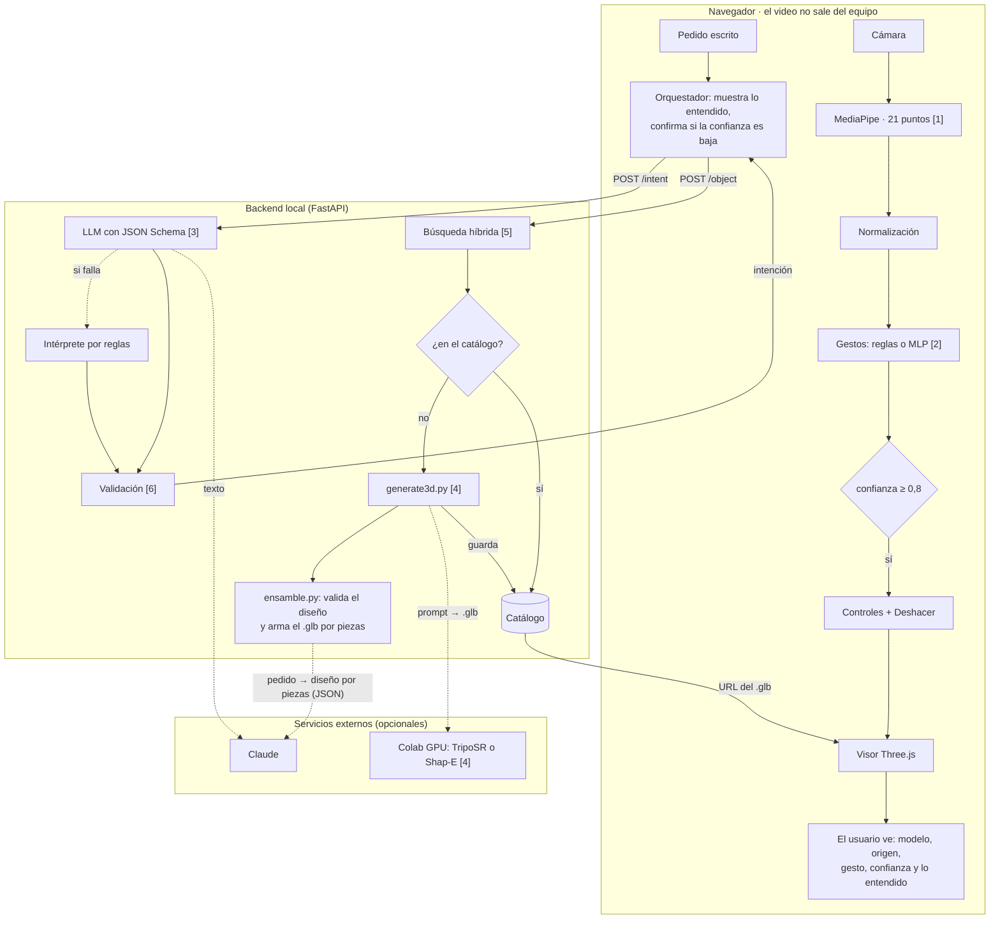

# Arquitectura de la solución (entregable 4)

El diagrama editable está en [`arquitectura.drawio`](arquitectura.drawio). Se abre con [draw.io](https://app.diagrams.net/) (**Archivo → Abrir**) o con la extensión de draw.io para VS Code. Para las diapositivas: **Archivo → Exportar como → PNG**.

Responde lo que pide el entregable: **qué entra, qué decide o genera la IA y qué ve el usuario**. Los números entre corchetes son las técnicas de la tabla de la sección 5.7 de la propuesta.

## Vista rápida

## Los dos flujos (sección 7.3)

**Flujo 1: manipular el objeto con gestos.** Corre completo en el navegador.
1. La cámara entrega un fotograma y MediaPipe devuelve 21 puntos por mano [1].
2. Los puntos se normalizan: origen en la muñeca y escala según el tamaño de la mano.
3. El clasificador decide el gesto [2]. La confianza es la proporción de los últimos 6 fotogramas que coinciden.
4. Si la confianza llega a 0,8, los controles mueven, rotan, escalan o reinician el objeto. Antes de cada gesto se guarda el estado, para poder deshacerlo.
5. El recuadro de cámara muestra el esqueleto y el gesto: cian si se aplica, ámbar si solo se detecta.

**Flujo 2: pedir un objeto con lenguaje natural.**
1. El pedido escrito va a `POST /intent`. El LLM lo convierte en un JSON con esquema fijo [3]. Si no hay clave o falla, lo interpreta el intérprete por reglas.
2. La intención se valida [6]: esquema, objetos fuera del dominio, límites y pedidos por minuto.
3. El visor muestra lo entendido y pide confirmación si la confianza es menor a 0,5.
4. El objeto va a `POST /object`. La búsqueda híbrida [5] prueba primero por palabras clave y después por embeddings.
5. Si está en el catálogo, se devuelve. Si no, se genera [4], se guarda en el catálogo y se devuelve. El próximo pedido parecido sale al instante. Hay dos generadores:
   - **Por piezas** (por defecto con clave de API): Claude devuelve el diseño del objeto como un JSON de piezas, cada una hecha de formas simples con medidas, material, orden de desmontaje y dirección de salida. `ensamble.py` valida el diseño (formas, medidas y cantidades dentro de rango) y lo convierte en un `.glb` con un nodo por pieza.
   - **Colab** (TripoSR o Shap-E): devuelve una sola malla; se valida el `.glb` (cabecera, largo y tamaño).
6. El visor carga el modelo y muestra su origen: "del catálogo" o "generado por IA, no apto para fabricación sin revisión".
7. Si el modelo tiene piezas, el panel **Piezas** las lista. Se desmontan de a una (botón, tecla `X`, gesto de señalar o "sacale una pieza"), se separan todas con la vista explotada ("mostrame la válvula desarmada") y se vuelven a armar. Cada pieza sale en su dirección y a una distancia que depende de su orden, para que no se superpongan.

**Si algo falla:** sin backend, el visor busca en el catálogo local; sin LLM, interpreta con reglas; sin cámara, quedan los botones y el teclado; sin servidor de generación, se usan solo los modelos del catálogo.

## Dónde corre cada parte (sección 7.4)

| Componente | Dónde corre | Motivo |
|---|---|---|
| MediaPipe, clasificador de gestos, visor | Navegador del usuario | Latencia baja y privacidad: el video nunca sale del equipo |
| Three.js, MediaPipe y modelo de manos | `frontend/vendor/` (dentro del proyecto) | Funciona sin internet (riesgo 2) |
| Interpretación del pedido | Backend local + Claude (externo) | Calidad de comprensión; respaldo por reglas sin red |
| Validación, búsqueda y catálogo | Backend local | Sin dependencia de internet en la demo |
| Generación 3D por piezas | Backend local + Claude (externo) | No necesita GPU; el diseño se valida y se arma en el backend |
| Generación 3D con TripoSR o Shap-E | Colab con GPU (externo) | Necesita GPU; lo generado queda en el catálogo |

## Contratos (backend)

| Método | Ruta | Recibe | Devuelve |
|---|---|---|---|
| GET | `/health` | — | estado, tipo de búsqueda, cantidad de modelos del catálogo, generador activo (`ensamble`, `remoto` o `desactivado`) |
| POST | `/intent` | `{"frase"}` | `{"accion", "objeto", "parametros": {"vista", "factor_escala"}, "confianza", "requiere_confirmacion", "motor"}` · acciones: mostrar, rotar, escalar, vista, reiniciar, desmontar, explotar, armar, desconocido |
| POST | `/object` | `{"frase"}` (el objeto) | `{"origen", "id", "nombre", "modelo_url", "similitud", "metodo"}` · 404 si no está y no se puede generar · 422 si está fuera del dominio |
| GET | `/catalog` | — | la lista de piezas del catálogo |

## Qué archivo implementa cada técnica

| Técnica (sección 5.7) | Archivos |
|---|---|
| [1] Visión por computadora | `frontend/js/hands.js` |
| [2] Reglas + MLP | `frontend/js/normalize.js`, `gestures.js`, `mlp.js`, `controles.js` · `ml/extraer_hagrid.py`, `ml/entrenar_mlp.py` (datos de HaGRID), `ml/train_mlp.ipynb` (dataset propio) |
| [3] LLM | `backend/intent.py`, `backend/prompts/intent_system.txt` · respaldo entrenado sin internet: `backend/intent_modelo.py`, `ml/intencion/` · pedidos por voz: `frontend/js/voz.js` |
| [4] IA generativa 3D | `backend/generate3d.py`, `backend/ensamble.py`, `backend/geometria.py`, `backend/prompts/ensamble_system.txt`, `backend/generador_colab/servidor_generacion.ipynb` |
| Desarmado por piezas | `frontend/js/piezas.js`, `frontend/js/viewer.js` |
| Holograma (y cámara de fondo opcional) | `frontend/js/holograma.js`, `frontend/js/etiquetas.js`, `frontend/js/viewer.js`, `frontend/js/overlay.js` |
| Actividad de la IA en vivo | `frontend/js/actividad.js`, `frontend/js/panel_actividad.js`, `frontend/actividad.html` · traza del LLM en `backend/intent.py` |
| [5] Embeddings y búsqueda | `backend/retrieval.py` |
| [6] Reglas de seguridad | `backend/safety.py`, `backend/schemas.py` |

Las decisiones detrás de cada elección están en [decisiones.md](decisiones.md).
